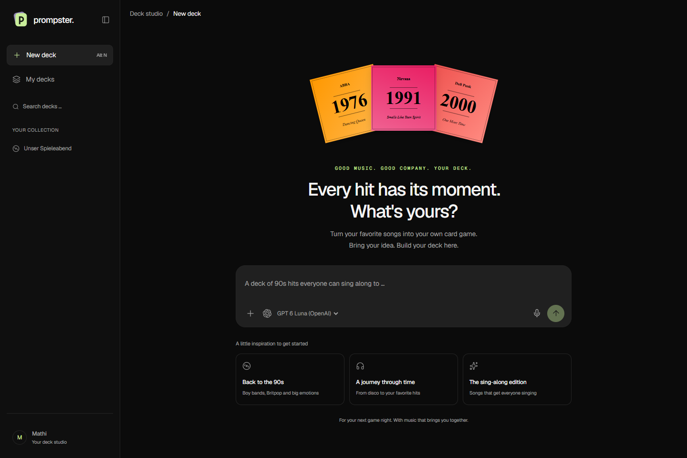
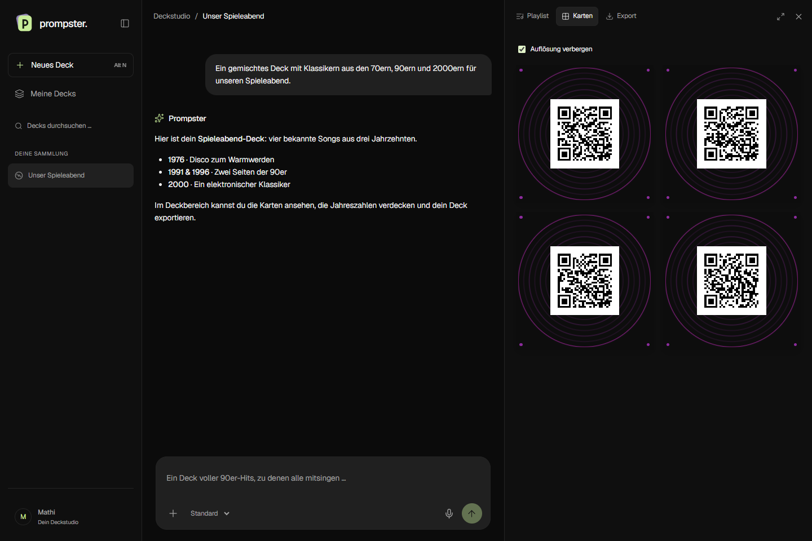
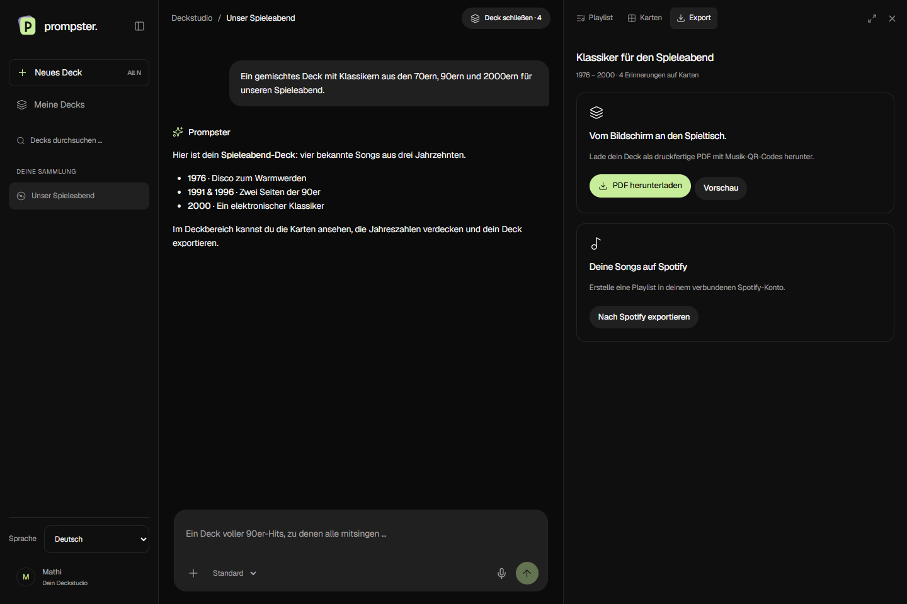

# prompster

**Turn your favourite music into a card game.**

Describe the songs you want to hear tonight. Prompster puts together the playlist with you and turns it into a printable music-guessing deck: one side a QR code that plays the song, the other side the artist, title and year it came out.

  
   
  One sentence in, a playlist out. <a href="docs/reviews/playlist-choreography/deck-build.mp4">Watch in full quality (MP4)</a>

## How a deck comes together

**1. Say what you're in the mood for.**
A decade, a genre, a vibe, a handful of artists you love, or a whole evening in one sentence: *"Disco, pop and a bit of indie from the '70s to the 2000s. Songs everyone can sing along to."* Type it or just say it.

**2. Shape it in conversation.**
Prompster digs through Spotify while you watch: every search shows up in the chat and every find lands in the playlist right away. Ask for more '90s, fewer ballads or a different mix of eras, and the playlist updates as you talk. You can also add or remove songs by hand.

**3. Check the cards.**
Flip between the playlist and the finished cards. Hide the answers to see the deck the way your players will.

**4. Bring it to the table.**
Download a print-ready PDF and cut out the cards, or save the songs as a playlist in your Spotify account.

| Start with an idea | Get your cards |
| --- | --- |
|  |  |
| **Play without spoilers** | **Print it or take it to Spotify** |
|  |  |

## Take the tour

  
   
  <a href="docs/reviews/lit-frontend/desktop-walkthrough.mp4">Watch the full walkthrough (MP4)</a>

## On your phone, too

<table>
  <tr>
    <td width="260">
      
    </td>
    <td>
      Start a deck on the couch and finish it on the way to the party. The whole studio works on your phone, from dictating your idea to flipping through the cards.
        
      All your decks are saved, so you can come back later, change a few songs and print a new round.
        
      <a href="docs/reviews/lit-frontend/mobile-walkthrough.mp4">Watch the mobile walkthrough (MP4)</a>
    </td>
  </tr>
</table>

## Made for

- **Game nights** with friends who all grew up on different music
- **Birthdays and family gatherings**, with a deck built around the guest of honour's favourite years
- **Theme parties**: an '80s night, a summer-hits evening, film soundtracks
- **Gifts**: a printed deck of songs that mean something to the two of you

## Good to know

- Sign in with Spotify or Google.
- Decks hold up to 50 songs.
- Playing songs in the browser requires Spotify Premium. Exporting a playlist requires a connected Spotify account.
- Available in English and German.

---

Want to run Prompster yourself? The [setup guide](docs/getting-started.md) covers everything you need. More screenshots are in the [gallery](docs/reviews/lit-frontend/README.md).
