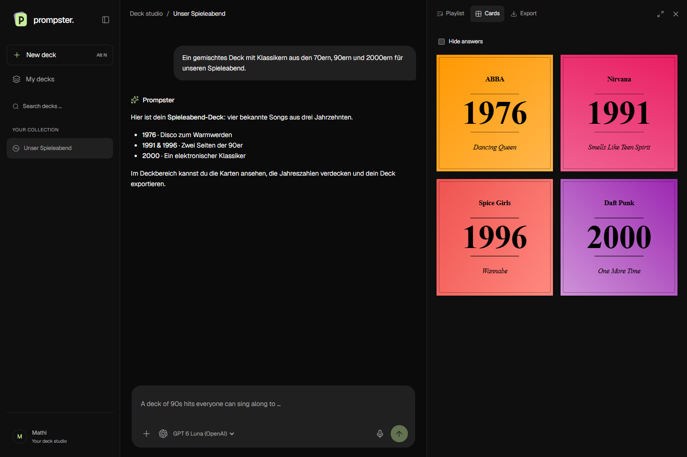
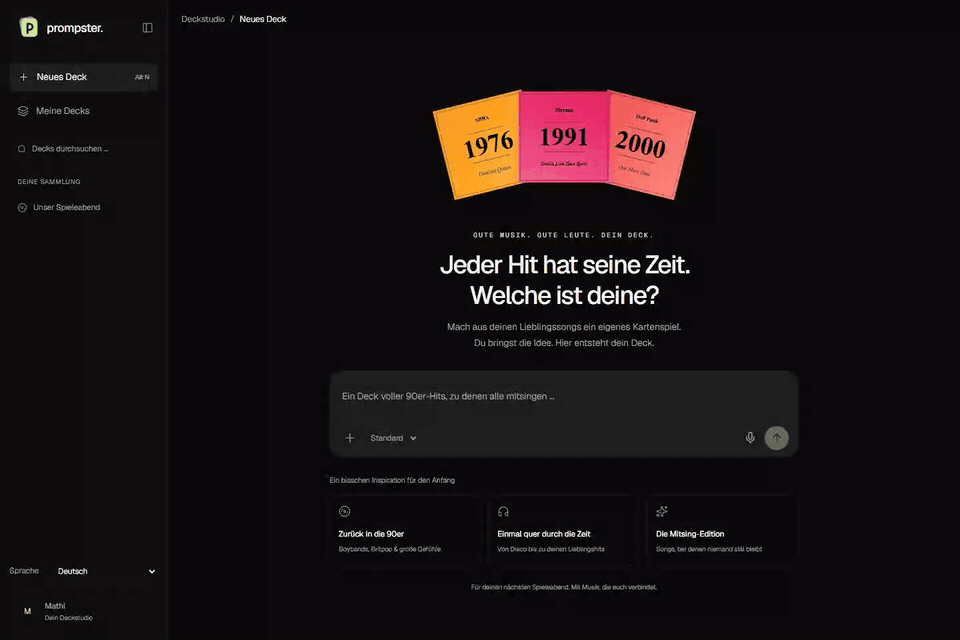
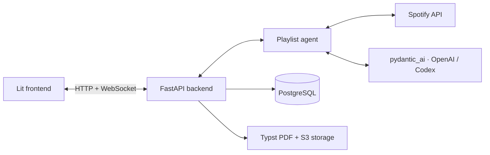

# prompster

**Turn a music prompt into game night.**

Describe the music you love. Prompster researches Spotify, builds a playlist with you, and turns it into a printable, Hitster-style card deck. Fine-tune the selection in chat, curate it by hand, then take it to Spotify or the table.

[](https://github.com/mathisarends/prompster/actions/workflows/frontend-ci.yml)
[](https://github.com/mathisarends/prompster/actions/workflows/backend-ci.yml)

[Demos](#demos) · [Run locally](#run-locally) · [How it works](#how-it-works) · [Development](#development)



## From a prompt to a deck

> “Build a deck for our game night: disco, pop and a little indie, from the '70s to the 2000s. Songs everyone can sing along to.”

1. **Set the direction.** Start with a mood, an era, a genre, or a few favourites. Add artist and playlist references or images for context.
2. **Build it together.** Answer follow-up questions and watch the agent's research and playlist updates as they arrive.
3. **Make it yours.** Ask for changes, add or remove tracks, and switch between the playlist and card previews. Hide the answers to reveal the QR side.
4. **Bring the music.** Export a Spotify playlist or download cards with QR codes, song titles, artists, and release years.

The studio works on **desktop and mobile**, with **German and English** interfaces and browser-supported voice dictation. Decks currently support **up to 50 tracks**. In-browser Spotify playback requires **Spotify Premium**; Spotify export requires a connected account.

## Demos

Explore the studio, refine a deck, preview both sides of the cards, and switch languages. Click a preview for the full MP4 walkthrough.

| Desktop studio | On your phone |
| --- | --- |
| [](docs/reviews/lit-frontend/desktop-walkthrough.mp4) | [](docs/reviews/lit-frontend/mobile-walkthrough.mp4) |
| [Watch desktop demo · MP4](docs/reviews/lit-frontend/desktop-walkthrough.mp4) | [Watch mobile demo · MP4](docs/reviews/lit-frontend/mobile-walkthrough.mp4) |

The recordings use controlled API responses and simulated speech recognition. They demonstrate the interface and interactions; live AI, OAuth, Spotify playback, microphone recognition, and actual exports are not exercised. See the [full gallery and recording instructions](docs/reviews/lit-frontend/README.md).

## Run locally

You'll need **Docker with Compose v2**, **Node.js 24**, a **Spotify developer app**, and an **OpenAI API key** for the default model configuration. Google sign-in is optional.

```bash
git clone https://github.com/mathisarends/prompster.git
cd prompster
cp .env.example .env
```

Fill in `.env` before starting: Spotify credentials, the token encryption key, and your OpenAI key. Use `http://127.0.0.1:8000/api/v1/auth/spotify/callback` for the Spotify redirect URI. The [setup guide](docs/getting-started.md) walks through key generation, OAuth callbacks, and optional Google sign-in.

```bash
# API, database, object storage, and migrations
docker compose up --build -d

# Frontend (runs outside Docker)
npm --prefix frontend ci
npm --prefix frontend run dev
```

Open **[127.0.0.1:5173](http://127.0.0.1:5173)** and sign in with Spotify or your configured Google app. Keep `127.0.0.1` consistent across the frontend and OAuth callbacks.

| Local service | Address |
| --- | --- |
| App | [127.0.0.1:5173](http://127.0.0.1:5173) |
| API docs | [127.0.0.1:8000/docs](http://127.0.0.1:8000/docs) |
| MinIO console | [127.0.0.1:9001](http://127.0.0.1:9001) |
| Database browser | [127.0.0.1:8080](http://127.0.0.1:8080) |

**Using a Codex login?** The model selector distinguishes OpenAI API models from Codex models. See [Codex authentication](docs/getting-started.md#codex-authentication) for the local login and read-only Docker credential mount. Background tasks still use the default OpenAI model in the current configuration.

## How it works

The Lit frontend talks to FastAPI over HTTP and typed JSON-RPC WebSocket streams. The agent researches Spotify and updates a shared deck draft; the backend persists the session and handles exports.



| Location | Responsibility |
| --- | --- |
| [`frontend/`](frontend/README.md) | Lit 3, TypeScript, Vite, TanStack Lit Query; chat, cards, and playback |
| [`backend/`](backend/README.md) | FastAPI, OAuth, sessions, Spotify export, and PDF generation |
| [`libs/agent/`](libs/agent/README.md) | harnessed agent, Spotify research, deck state, and streaming events |
| [`schema/`](schema/) | Generated OpenRPC contract for the session stream |

The Python packages share a **uv workspace and lockfile**. [`harnessed`](https://github.com/mathisarends/harnessed) runs the agent, and [`pydantic_ai`](https://github.com/pydantic/pydantic-ai) supplies the model clients.

## Development

With **Python 3.14+** and **uv** installed, run these commands from the repository root:

```bash
uv sync --all-packages --dev
uv run pytest backend/tests/ -v
uv run --package agent pytest libs/agent/tests/
uv run --package backend fastapi-canon websockets generate --config rpcgen.toml --check

npm --prefix frontend run lint
npm --prefix frontend test
npm --prefix frontend run build
```

The Compose stack mounts the backend and agent source for local iteration. To regenerate the RPC contract and TypeScript client after changing a stream:

```bash
uv run --package backend fastapi-canon websockets generate --config rpcgen.toml
```

For HTTP client generation, export the backend schema and regenerate the client:

```bash
npm --prefix frontend run api:export
npm --prefix frontend run api:generate
```

The [frontend guide](frontend/README.md) also covers browser tests, translation checks, and the recording workflow.

[Setup & troubleshooting](docs/getting-started.md) · [Database migrations](docs/migration.md) · [Backend internals](backend/README.md) · [Agent internals](libs/agent/README.md)
