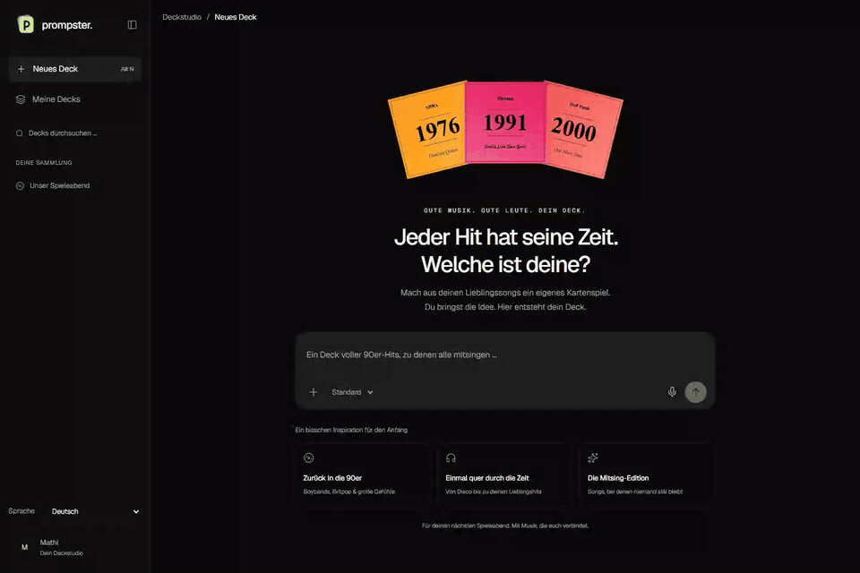
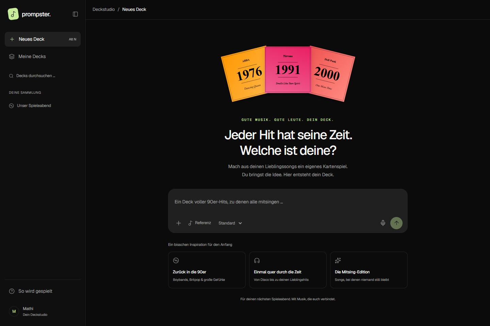
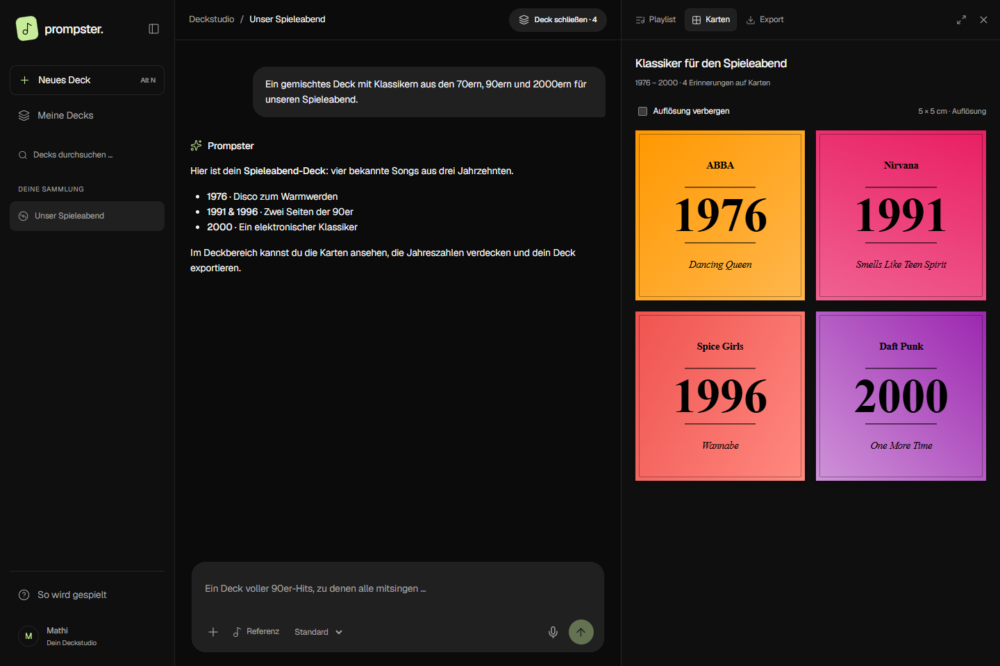

# Lit frontend: review gallery

Recorded on 2026-10-03 from application commit `f9cb0cf` in Chrome. Desktop:
1440 × 960; mobile: 390 × 844. The screenshots and videos use controlled HTTP
and WebSocket fixtures plus a simulated browser speech-recognition service.
They demonstrate layout, navigation, dictation controls and interactions;
they do not demonstrate live AI, OAuth, Spotify playback, real microphone
recognition or actual exports.
The production application uses the real backend.

## Walkthroughs

| View    | Video                                      | Covered interactions                                                                                                                |
| ------- | ------------------------------------------ | ----------------------------------------------------------------------------------------------------------------------------------- |
| Desktop | [MP4 walkthrough](desktop-walkthrough.mp4) | Studio, dictation preview/accept, prompt starter, chat, full-height workspace, cards, QR side, expansion, export, library, settings |
| Mobile  | [MP4 walkthrough](mobile-walkthrough.mp4)  | Studio, dictation preview/discard, sidebar, existing session, chat, deck, cards, QR side, return to chat                            |

### Desktop preview



### Mobile preview


## Screenshots

| Desktop                                                | Mobile                              |
| ------------------------------------------------------ | ----------------------------------- |
| [01 · Login](01-login-desktop.png)                     | [08 · Studio](08-studio-mobile.png) |
| [02 · Studio](02-studio-desktop.png)                   | [09 · Chat](09-chat-mobile.png)     |
| [03 · Chat and playlist](03-chat-playlist-desktop.png) | [10 · Cards](10-cards-mobile.png)   |
| [04 · Cards](04-cards-desktop.png)                     |                                     |
| [05 · Export options](05-export-desktop.png)           |                                     |
| [06 · Library](06-library-desktop.png)                 |                                     |
| [07 · Settings](07-settings-desktop.png)               |                                     |

### Workspace and voice input

- [11 · QR side of the cards](11-qr-desktop.png)
- [12 · Expanded workspace](12-workspace-expanded.png)
- [13 · Desktop dictation preview](13-dictation-desktop.png)
- [14 · Mobile dictation preview](14-dictation-mobile.png)

The 14 screenshots include the full-height workspace with keyboard-accessible
tabs, compact composer and both card faces. Card colors and proportions follow
the existing PDF template; its precise print font and crop marks remain in the
generated PDF. The browser preview uses an available serif font.





## Reproduce

From `frontend`, run `npm ci`, then start Vite in one terminal:

```sh
npm run dev -- --port 5175 --strictPort
```

In a second terminal, run `npm run review:capture`. `REVIEW_BASE_URL` can override
the default URL. Windows uses installed Chrome; other platforms need
`npx playwright install chromium` first. The capture script shares the browser
test fixtures, waits for fonts, checks page errors and mobile overflow, and saves
screenshots here and raw WebM recordings in `frontend/test-results/review-raw`.

With FFmpeg installed, run these commands from the repository root to produce
the portable H.264 videos and inline GIF previews:

```sh
ffmpeg -y -ss 0.5 -i frontend/test-results/review-raw/desktop.webm -c:v libx264 -preset slow -crf 25 -pix_fmt yuv420p -movflags +faststart -an docs/reviews/lit-frontend/desktop-walkthrough.mp4
ffmpeg -y -ss 0.5 -i frontend/test-results/review-raw/desktop.webm -filter_complex "fps=10,scale=960:-1:flags=lanczos,split[a][b];[a]palettegen=max_colors=96[p];[b][p]paletteuse=dither=bayer:bayer_scale=3" -loop 0 docs/reviews/lit-frontend/desktop-preview.gif
ffmpeg -y -ss 0.5 -i frontend/test-results/review-raw/mobile.webm -c:v libx264 -preset slow -crf 24 -pix_fmt yuv420p -movflags +faststart -an docs/reviews/lit-frontend/mobile-walkthrough.mp4
ffmpeg -y -ss 0.5 -i frontend/test-results/review-raw/mobile.webm -filter_complex "fps=10,split[a][b];[a]palettegen=max_colors=96[p];[b][p]paletteuse=dither=bayer:bayer_scale=3" -loop 0 docs/reviews/lit-frontend/mobile-preview.gif
```

The MP4 files retain the original viewport dimensions; the desktop GIF is
scaled to 960 pixels wide for the PR. Raw recordings are excluded from Git.
